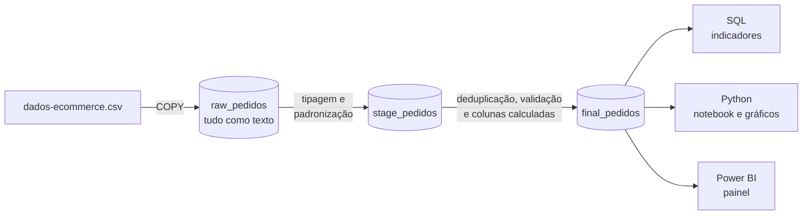
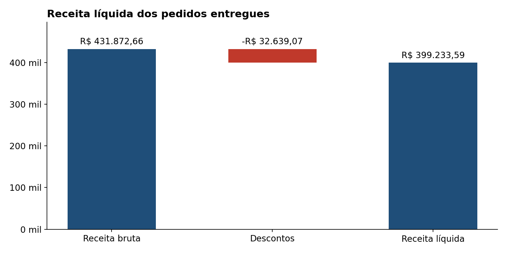
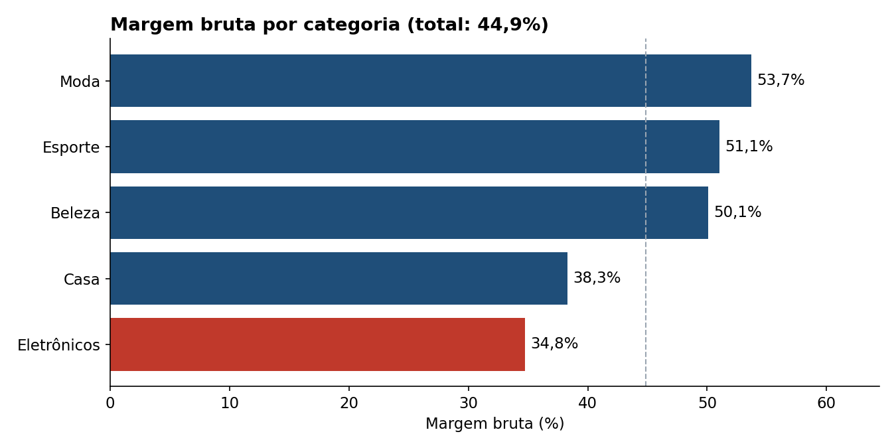
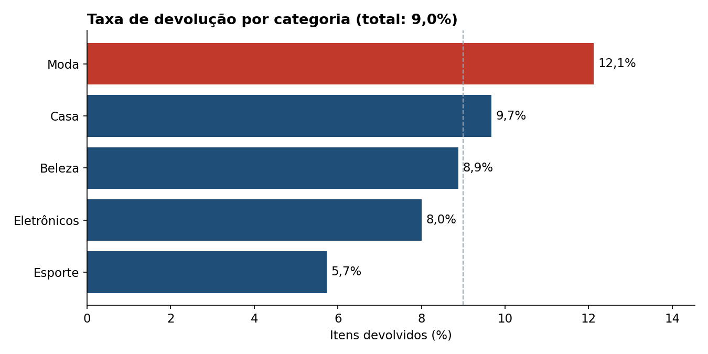
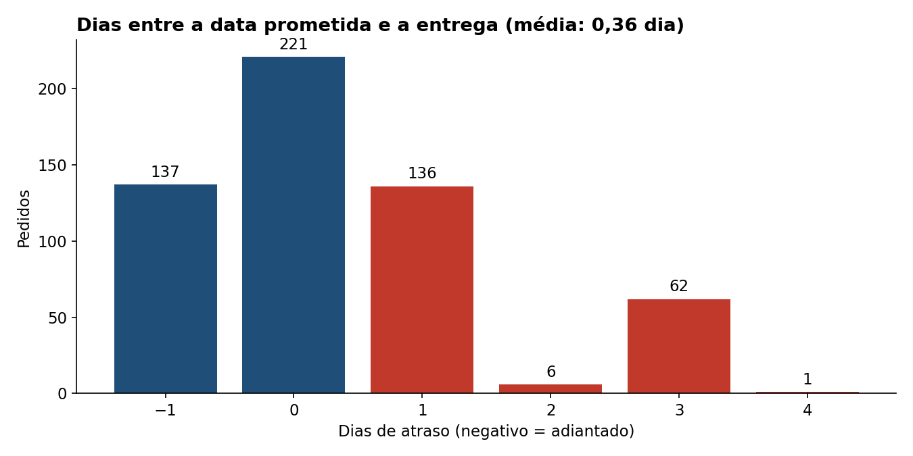
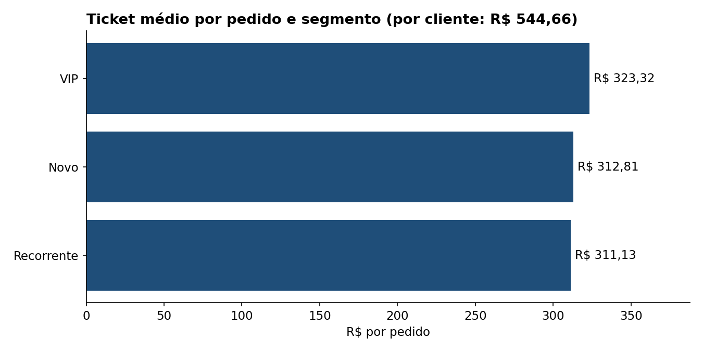

# 🧹 Pipeline de dados de e-commerce: PostgreSQL → Python → Power BI

Projeto completo de análise de vendas: uma base **suja** é limpa em SQL em três camadas (**raw → stage → final**), e a tabela tratada alimenta os **5 indicadores do negócio** em Python e no Power BI:

1. Receita líquida
2. Margem bruta por produto e categoria
3. Taxa de devolução
4. Atraso médio na entrega
5. Ticket médio por cliente

O projeto começou no curso **"Análise de Dados com IA: SQL, Python e Power BI" (Alura)**, em que parte do código foi gerada com a ajuda do Copilot. Depois revisei os resultados e encontrei **erros nos dados e nas fórmulas que mudavam as conclusões**. Esta é a versão revisada.

## 📌 O que a revisão encontrou

1. **A data de entrega estava com dia e mês invertidos.** Lida como DD/MM (como no curso), a entrega aparecia de 321 dias *antes* a 339 dias *depois* do pedido. Lida como MM/DD, fica entre 5 dias antes e 16 depois, coerente com o prazo prometido de 2 a 15 dias. Com a leitura errada, o painel do curso mostrava **115 dias** de atraso médio. O valor real é **0,36 dia**.
2. **A receita somava pedidos cancelados e devolvidos**, além de 22 linhas duplicadas e um preço de R$ 9.999,99.
3. **A margem bruta % misturava bases diferentes:** margem calculada sem desconto dividida por receita com desconto. O valor final ficou parecido com o real **por coincidência**: dois erros em sentidos opostos se anularam (ignorar o desconto aumenta a margem; custos de preenchimento de R$ 7.999,90 diminuem).
4. **A mesma categoria estava escrita de jeitos diferentes** ("Beleza", "beleza ", "Esporte", "Esportes"), o que dividia os totais em 9 categorias em vez de 5.

| Indicador | Painel do curso | Versão revisada |
|---|---:|---:|
| Receita líquida | R$ 482.802,80 | **R$ 399.233,59** |
| Margem bruta % | 45,5% | **44,9%** |
| Taxa de devolução | 8,6% | **9,0%** |
| Atraso médio na entrega | 115 dias | **0,36 dia** |
| Ticket médio por cliente | R$ 625,39 | **R$ 544,66** |

*Valores do painel do curso calculados com as medidas DAX originais sobre a tabela final da primeira versão. A mesma receita (R$ 482.802,80) aparece no notebook Python do curso.*

A IA gerou o código em segundos, mas foi a validação dos resultados que mostrou que eles estavam errados.

## ⚙️ Arquitetura



Toda a limpeza acontece **uma única vez, no SQL**. Python e Power BI só leem a tabela final, então os três chegam aos mesmos números. No curso, a limpeza era refeita em cada ferramenta, cada uma com regras um pouco diferentes.

| Etapa | Onde | O que faz |
|---|---|---|
| **raw** | [`01_raw.sql`](sql/pipeline/01_raw.sql) | Carrega o CSV sem alterar nada. Tudo é `TEXT`, para nenhuma linha ser rejeitada |
| **stage** | [`02_stage.sql`](sql/pipeline/02_stage.sql) | Converte datas e números (validando com regex antes), padroniza textos e completa estado e região vazios a partir da cidade |
| **final** | [`03_final.sql`](sql/pipeline/03_final.sql) | Remove duplicatas, corrige a categoria pelo padrão de cada produto, anula valores impossíveis, marca problemas em colunas `flag_` e calcula receita, custo, margem e atraso |
| **SQL** | [`05_indicadores.sql`](sql/analises/05_indicadores.sql) | Os 5 indicadores em SQL |
| **Python** | [`indicadores.ipynb`](python/indicadores.ipynb) | Lê do PostgreSQL com SQLAlchemy, recalcula os indicadores e gera os gráficos |
| **Power BI** | [`medidas.dax`](powerbi/medidas.dax) | Medidas DAX originais e corrigidas, com o motivo de cada correção |

**Decisão importante:** nenhuma linha é apagada por ter um campo ruim. Um custo inválido vira `NULL`, mas a receita, o frete e a devolução daquela linha continuam valendo. Cada problema fica registrado numa coluna `flag_`, então dá para auditar o que foi corrigido.

## 🧹 Problemas tratados

Resultado de [`04_qualidade_dos_dados.sql`](sql/analises/04_qualidade_dos_dados.sql):

| Problema | Antes | Depois |
|---|---:|---:|
| Linhas duplicadas (mesmo pedido + item) | 22 | 0 |
| Canal de venda fora do padrão (`APP`, `" Site "`, `Loja fisica`) | 4 | 0 |
| Categoria fora do padrão (`beleza `, `eletronicos`, `Esportes`) | 7 | 0 |
| Categoria errada para o produto (ex.: jaqueta em "Beleza") | 12 | 0 |
| Forma de pagamento fora do padrão (`cartao de credito`, `pix`) | 9 | 0 |
| "Devolvido" fora do padrão (`sim`, `nao`, `N`) | 7 | 0 |
| Estado vazio ou em minúsculas | 5 | 0 |
| Região vazia | 4 | 0 |
| Produto sem nome | 5 | 0 |
| Quantidade zero ou negativa | 8 | 0 |
| Preço ≤ 0 ou fora do padrão do produto | 6 | 0 |
| Custo ≤ 0 ou fora do padrão do produto | 6 | 0 |
| Frete negativo | 6 | 0 |
| Entrega antes do pedido (com a leitura de data correta) | 3 | 0 |

**Regra para preço e custo:** o valor é válido se for maior que zero e estiver no máximo 5 vezes acima ou abaixo da **mediana do próprio produto**. A regra pega os valores de preenchimento sem precisar listá-los um a um.

**O que não dá para corrigir, só sinalizar:**
- **906 pedidos "Entregue" sem data de entrega.** Seguindo a decisão do curso, as datas não são inventadas: esses pedidos ficam fora do cálculo de atraso, mas continuam nos outros indicadores.
- **15 itens em que o status contradiz a coluna "devolvido"** (ex.: status "Devolvido" com devolvido = "Não").
- **17 itens sem data do pedido.**

## 📊 Indicadores

Receita líquida = quantidade × preço × (1 − desconto). Margem bruta = receita líquida − custo. Receita, margem e ticket consideram só pedidos **entregues**: pedido cancelado ou devolvido não gera receita.

### 1. Receita líquida


Dos R$ 431.873 vendidos a preço cheio em 1.072 pedidos entregues, R$ 32.639 (7,6%) foram concedidos em desconto.

### 2. Margem bruta


A margem bruta total é de **R$ 178.769 (44,9%)**. Eletrônicos é a 2ª categoria em receita, mas tem a menor margem. Os produtos de menor margem são Headset Gamer X (24,9%) e Air Fryer 4L (26,4%). Os de maior margem são Cabo USB-C Pro (66,9%) e Body Splash Fresh (66,5%).

### 3. Taxa de devolução


Moda tem a maior margem e também a maior taxa de devolução: **12,1%**, contra 9,0% no geral.

### 4. Atraso na entrega


Com os **563 pedidos entregues** que têm as duas datas: 24% chegaram adiantados, 39% no dia e 36% atrasados, quase todos de 1 a 3 dias. Mesmo atrasos curtos pesam na satisfação: a nota média cai de **4,32** para **3,89**.

### 5. Ticket médio por cliente


O ticket médio é de **R$ 544,66 por cliente** (733 clientes) e de **R$ 372,42 por pedido**. O segmento do cliente é registrado em cada pedido (o mesmo cliente aparece como "Novo" e depois como "Recorrente"), por isso a comparação entre segmentos usa o ticket por pedido. Os pedidos VIP são os de maior valor, mas a diferença é pequena.

Análises complementares (vendas por subcategoria, produtos mais vendidos, canais de venda e efeito dos cupons) estão em [`06_analises_complementares.sql`](sql/analises/06_analises_complementares.sql), com os resultados na pasta [`resultados/`](resultados).

## 🛠️ Técnicas usadas

**SQL (PostgreSQL)**
- Validação com regex (`~`) antes de converter tipos com `to_date` e `CAST`
- Função própria (`CREATE FUNCTION`) para comparar textos sem acento, espaço ou maiúsculas
- Funções de janela: `ROW_NUMBER` para remover duplicatas, `MAX() OVER (PARTITION BY)` para preencher estado e região vazios, `RANK` para ranking
- Agregações estatísticas: `mode()` e `percentile_cont` (mediana) para definir o padrão de cada produto
- `CTE`, `CASE`, `COALESCE`, `NULLIF`, `FILTER`, `ROLLUP`, `LATERAL`
- Modelagem em camadas (raw, stage e final) e flags de qualidade de dados

**Python:** Pandas, SQLAlchemy e Matplotlib, com leitura direta do banco.

**Power BI:** medidas DAX com `CALCULATE`, `DIVIDE` e `DISTINCTCOUNT`, e conexão com PostgreSQL.

**Infraestrutura:** Docker Compose. Um comando sobe o banco já com o pipeline executado.

## ▶️ Como executar

Precisa do [Docker Desktop](https://www.docker.com/products/docker-desktop/).

```bash
docker compose up -d
```

Na primeira inicialização, o PostgreSQL carrega o CSV e roda as três camadas automaticamente.

**SQL:**
```bash
docker exec -i pipeline-etl-postgres psql -U analista -d ecommerce < sql/analises/05_indicadores.sql
```

**Python:**
```bash
pip install -r python/requirements.txt
jupyter notebook python/indicadores.ipynb
```

**Power BI e pgAdmin:** host `localhost`, porta `5435`, banco `ecommerce`, usuário e senha `analista`. O passo a passo para apontar o painel está em [`powerbi/README.md`](powerbi/README.md).

Para reconstruir o banco do zero: `docker compose down -v` e depois `docker compose up -d`.

## 📂 Estrutura

```
├── data/dados-ecommerce.csv     # base fictícia do curso (1.722 linhas)
├── sql/
│   ├── pipeline/                # 01_raw, 02_stage, 03_final (rodam no docker compose up)
│   ├── analises/                # qualidade dos dados, 5 indicadores e análises extras
│   └── v1_original/             # minha primeira versão, feita durante o curso
├── python/indicadores.ipynb     # indicadores e gráficos em Python
├── powerbi/medidas.dax          # medidas DAX originais e corrigidas
├── imagens/                     # gráficos gerados pelo notebook
├── resultados/                  # saída das consultas SQL
└── docker-compose.yml
```

## 📝 Sobre os dados

Base **fictícia** de 1.722 itens de pedidos (jan/2024 a mar/2025), fornecida no curso "Análise de Dados com IA: SQL, Python e Power BI" da Alura. Os erros nos dados fazem parte do exercício.

Na minha primeira versão da camada stage ([`v1_original`](sql/v1_original)), a regex das datas prometida e de entrega ficou sem o mês, por um erro de digitação meu. Por isso todas essas datas viravam `NULL`. A correção está em `02_stage.sql`.

---
Desenvolvido por [Tania Miguel](https://github.com/taniamiguel) · [LinkedIn](https://www.linkedin.com/in/taniamiguel)
