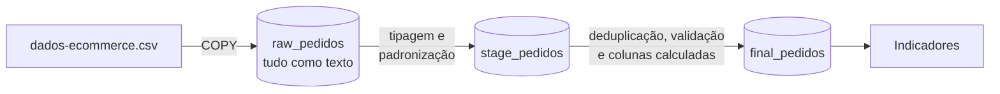

# 🧹 Pipeline ETL em PostgreSQL: limpeza e indicadores de e-commerce

Pipeline em SQL que transforma uma base de vendas **suja** em uma tabela confiável para análise, em três camadas (**raw → stage → final**), e calcula 5 indicadores de negócio: lucro, margem, taxa de devolução, atraso na entrega e ticket médio.

O projeto começou no curso **"Análise de Dados com IA: SQL, Python e Power BI" (Alura)**, em que parte do SQL foi gerada com a ajuda do Copilot. Depois revisei o resultado com calma e encontrei **erros que mudavam as conclusões**. Esta é a versão revisada.

## 📌 O que a revisão encontrou

1. **A data de entrega estava com dia e mês invertidos.** Lida como DD/MM (como na versão original), a entrega aparecia de 321 dias *antes* a 339 dias *depois* do pedido. Lida como MM/DD, fica entre −5 e +16 dias, coerente com o prazo prometido de 2 a 15 dias. Com a leitura errada, o **atraso médio era de 7,8 dias**. O valor real é **0,4 dia**.
2. **Custos com valor de preenchimento (R$ 7.999,90) e preços absurdos (R$ 9.999,99 e R$ 0,01)** derrubavam a margem. Eletrônicos aparecia com **9,8%** de margem, quando o valor real é **34,8%**.
3. **A mesma categoria escrita de jeitos diferentes** ("Beleza", "beleza ", "Esporte", "Esportes") dividia os totais em 9 categorias em vez de 5.

| Indicador | Versão original | Versão revisada |
|---|---:|---:|
| Lucro (pedidos entregues) | R$ 142.011 | **R$ 178.769** (+26%) |
| Margem total | 35,0% | **44,9%** |
| Margem de Eletrônicos | 9,8% | **34,8%** |
| Atraso médio na entrega | 7,8 dias | **0,4 dia** |
| Pedidos entregues com atraso | 51,4% | **36,4%** |
| Categorias | 9 | **5** |

A IA gerou o código em segundos, mas foi a validação dos resultados que mostrou que eles estavam errados.

## ⚙️ Como funciona o pipeline



| Camada | Arquivo | O que faz |
|---|---|---|
| **raw** | [`01_raw.sql`](sql/pipeline/01_raw.sql) | Carrega o CSV sem alterar nada. Tudo é `TEXT`, para nenhuma linha ser rejeitada |
| **stage** | [`02_stage.sql`](sql/pipeline/02_stage.sql) | Converte datas e números (validando com regex antes), padroniza textos e completa estado e região vazios a partir da cidade |
| **final** | [`03_final.sql`](sql/pipeline/03_final.sql) | Remove duplicatas, corrige a categoria pelo padrão de cada produto, anula valores impossíveis, marca problemas em colunas `flag_` e calcula faturamento, lucro e atraso |

**Decisão importante:** nenhuma linha é apagada por ter um campo ruim. Um custo inválido vira `NULL`, mas o faturamento, o frete e a devolução daquela linha continuam valendo. Cada problema fica registrado numa coluna `flag_`, então dá para auditar o que foi corrigido.

## 🧹 Problemas tratados

Resultado de [`04_qualidade_dos_dados.sql`](sql/analises/04_qualidade_dos_dados.sql):

| Problema | Antes | Depois |
|---|---:|---:|
| Linhas duplicadas (mesmo pedido + item) | 22 | 0 |
| Canal de venda fora do padrão (`APP`, `" Site "`, `Loja fisica`) | 4 | 0 |
| Categoria fora do padrão (`beleza `, `eletronicos`, `Esportes`) | 7 | 0 |
| Categoria errada para o produto (ex.: jaqueta em "Beleza") | 12 | 0 |
| Forma de pagamento fora do padrão (`cartao de credito`, `pix`) | 9 | 0 |
| "Devolvido" fora do padrão (`sim`, `nao`, `N`) | 7 | 0 |
| Estado vazio ou em minúsculas | 5 | 0 |
| Região vazia | 4 | 0 |
| Produto sem nome | 5 | 0 |
| Quantidade zero ou negativa | 8 | 0 |
| Preço ≤ 0 ou fora do padrão do produto | 6 | 0 |
| Custo ≤ 0 ou fora do padrão do produto | 6 | 0 |
| Frete negativo | 6 | 0 |
| Entrega antes do pedido (com a leitura de data correta) | 3 | 0 |

**Regra para preço e custo:** o valor é válido se for maior que zero e estiver no máximo 5 vezes acima ou abaixo da **mediana do próprio produto**. A regra pega os valores de preenchimento sem precisar listá-los um a um.

**O que não dá para corrigir, só sinalizar:**
- **906 pedidos "Entregue" sem data de entrega.** Seguindo a decisão do curso, as datas não são inventadas: esses pedidos ficam fora do cálculo de atraso, mas continuam nos outros indicadores.
- **15 itens em que o status contradiz a coluna "devolvido"** (ex.: status "Devolvido" com devolvido = "Não").
- **17 itens sem data do pedido.**

## 📊 Indicadores

Resultados de [`05_indicadores.sql`](sql/analises/05_indicadores.sql). Faturamento = quantidade × preço × (1 − desconto). Lucro = faturamento − quantidade × custo. Os valores consideram pedidos com status "Entregue".

### 1. Lucro
| Faturamento | Custo | Lucro | Margem |
|---:|---:|---:|---:|
| R$ 398.323 | R$ 219.553 | **R$ 178.769** | **44,9%** |

### 2. Margem por categoria
| Categoria | Faturamento | Lucro | Margem |
|---|---:|---:|---:|
| Moda | R$ 99.876 | R$ 53.639 | **53,7%** |
| Esporte | R$ 62.226 | R$ 31.767 | 51,1% |
| Beleza | R$ 52.757 | R$ 26.429 | 50,1% |
| Casa | R$ 88.998 | R$ 34.096 | 38,3% |
| Eletrônicos | R$ 94.466 | R$ 32.837 | **34,8%** |

Eletrônicos é a 2ª categoria em faturamento, mas tem a menor margem. Os produtos de menor margem são Headset Gamer X (24,9%) e Air Fryer 4L (26,4%). Os de maior margem são Cabo USB-C Pro (66,9%) e Body Splash Fresh (66,5%).

### 3. Taxa de devolução
| Categoria | Itens | Devolvidos | Taxa |
|---|---:|---:|---:|
| **Moda** | 363 | 44 | **12,1%** |
| Casa | 310 | 30 | 9,7% |
| Beleza | 259 | 23 | 8,9% |
| Eletrônicos | 412 | 33 | 8,0% |
| Esporte | 279 | 16 | 5,7% |
| **Total** | 1.623 | 146 | **9,0%** |

Moda tem a maior margem e também a maior taxa de devolução.

### 4. Atraso na entrega
Calculado com os **563 pedidos entregues** que têm data prometida e data de entrega.

| Atraso médio | Pedidos atrasados | Atraso médio dos atrasados | Nota no prazo | Nota com atraso |
|---:|---:|---:|---:|---:|
| 0,4 dia | 36,4% | 1,6 dia | **4,32** | **3,89** |

Os atrasos são curtos (1,6 dia em média), mas já reduzem a avaliação do cliente em quase meio ponto.

### 5. Ticket médio por cliente
| Segmento | Clientes | Ticket médio | Pedidos por cliente |
|---|---:|---:|---:|
| VIP | 167 | **R$ 307,15** | 1,08 |
| Recorrente | 472 | R$ 270,86 | 1,44 |
| Novo | 438 | R$ 267,52 | 1,36 |
| **Geral** | 1.080 | **R$ 274,01** | 1,35 |

Clientes VIP gastam mais por pedido, mas compram com **menos frequência** que os recorrentes.

Análises complementares (vendas por subcategoria, produtos mais vendidos, canais de venda e efeito dos cupons) estão em [`06_analises_complementares.sql`](sql/analises/06_analises_complementares.sql), com os resultados na pasta [`resultados/`](resultados).

## 🛠️ Técnicas de SQL usadas

- **Validação com regex** (`~`) antes de converter tipos com `to_date` e `CAST`
- **Função própria** (`CREATE FUNCTION`) para comparar textos sem acento, espaço ou maiúsculas
- **Funções de janela**: `ROW_NUMBER` para remover duplicatas, `MAX() OVER (PARTITION BY)` para preencher estado e região vazios, `RANK` para ranking
- **Agregações estatísticas**: `mode()` e `percentile_cont` (mediana) para definir o padrão de cada produto
- `CTE`, `CASE`, `COALESCE`, `NULLIF`, `FILTER`, `ROLLUP`, `LATERAL`
- Modelagem em camadas (raw, stage e final) e flags de qualidade de dados

## ▶️ Como executar

Precisa do [Docker Desktop](https://www.docker.com/products/docker-desktop/).

```bash
docker compose up -d
```

Na primeira inicialização, o PostgreSQL carrega o CSV e roda as três camadas automaticamente. Para rodar as análises:

```bash
docker exec -i pipeline-etl-postgres psql -U analista -d ecommerce < sql/analises/05_indicadores.sql
```

Para abrir no **pgAdmin** ou no DBeaver: host `localhost`, porta `5435`, banco `ecommerce`, usuário e senha `analista`.

Para reconstruir o banco do zero: `docker compose down -v` e depois `docker compose up -d`.

## 📂 Estrutura

```
├── data/dados-ecommerce.csv     # base fictícia do curso (1.722 linhas)
├── sql/
│   ├── pipeline/                # 01_raw, 02_stage, 03_final (rodam no docker compose up)
│   ├── analises/                # qualidade dos dados, 5 indicadores e análises extras
│   └── v1_original/             # versão original feita no curso, para comparação
├── resultados/                  # saída de cada análise
└── docker-compose.yml
```

## 📝 Sobre os dados

Base **fictícia** de 1.722 itens de pedidos (jan/2024 a mar/2025), fornecida no curso "Análise de Dados com IA: SQL, Python e Power BI" da Alura. Os erros fazem parte do exercício.

---
Desenvolvido por [Tania Miguel](https://github.com/taniamiguel) · [LinkedIn](https://www.linkedin.com/in/taniamiguel)
